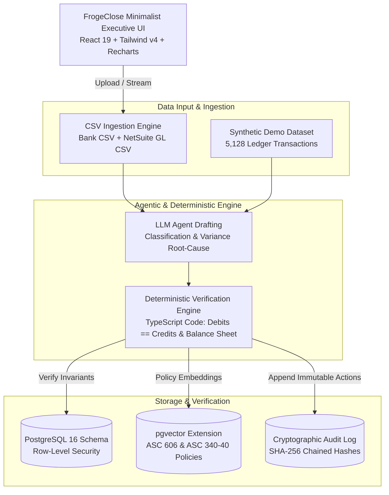

# FrogeClose: System Design & Technical Architecture Document
> **Data source:** Synthetic demo / Uploaded CSV  
> **Status:** Prototype on synthetic data

## 1. High-Level Architecture Diagram

---

## 2. Deterministic Accounting Invariants (Evaluated in Code)

Unlike probabilistic text generation, financial close requires strict mathematical determinism:

1. **Double-Entry Invariant:**
   $$\sum \text{Debits} \equiv \sum \text{Credits}$$
   Evaluated with zero decimal tolerance across all journal lines in the trial balance.
2. **Balance Sheet Equation:**
   $$\text{Total Assets} \equiv \text{Total Liabilities} + \text{Total Equity}$$
   Evaluated after rolling closed Net Income into Accumulated Deficit.
3. **ASC 340-40 Capitalization & Amortization:**
   Sales commissions are capitalized on the Balance Sheet as contract acquisition assets and amortized straight-line over contract life (36 months).
4. **Subledger to General Ledger Tie-Out:**
   Bank statement verified depository cash balance must tie exactly to General Ledger Cash Account #1010.
5. **Zero Suspense Balance & Duplicate Detection:**
   Account #9999 (Suspense) ending balance must equal $0.00, and transaction SHA-256 hashing verifies zero duplicate entries.

---

## 3. Security & Safety Model
- **Tenant Isolation:** Postgres Row-Level Security (`tenant_id = current_setting('app.current_org_id')`).
- **Confidence Thresholding:** Any classification below 90% confidence or with unverified PO >$10k is routed to the Controller Exception Inbox.
- **Controller Rollback:** One-click rollback restores the ledger to the pre-close snapshot if any discrepancy is found.
